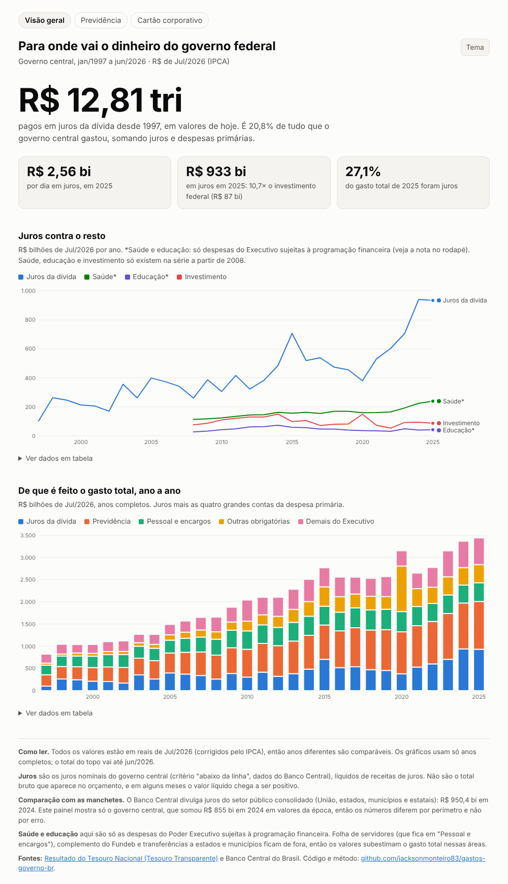
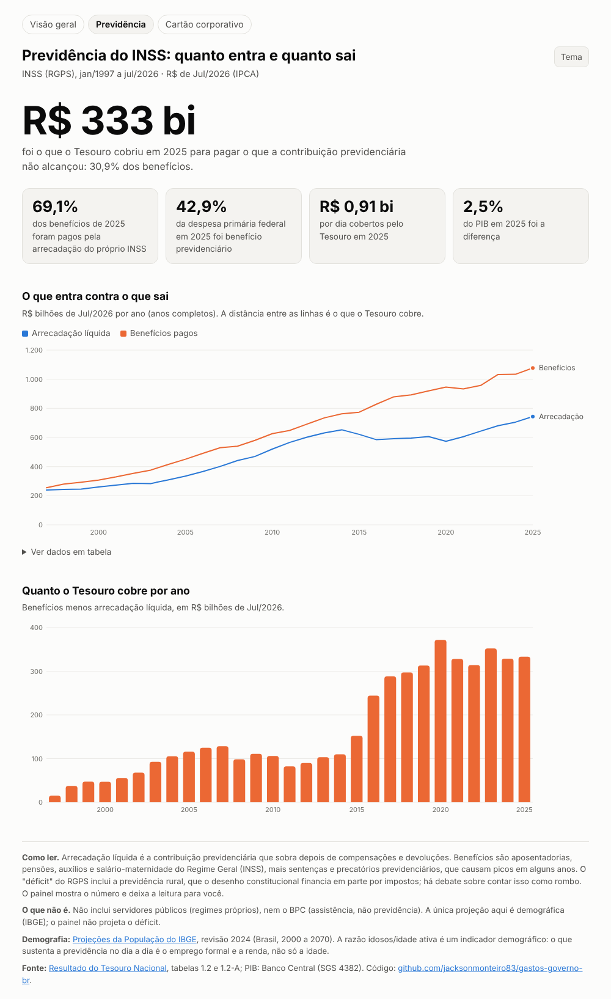
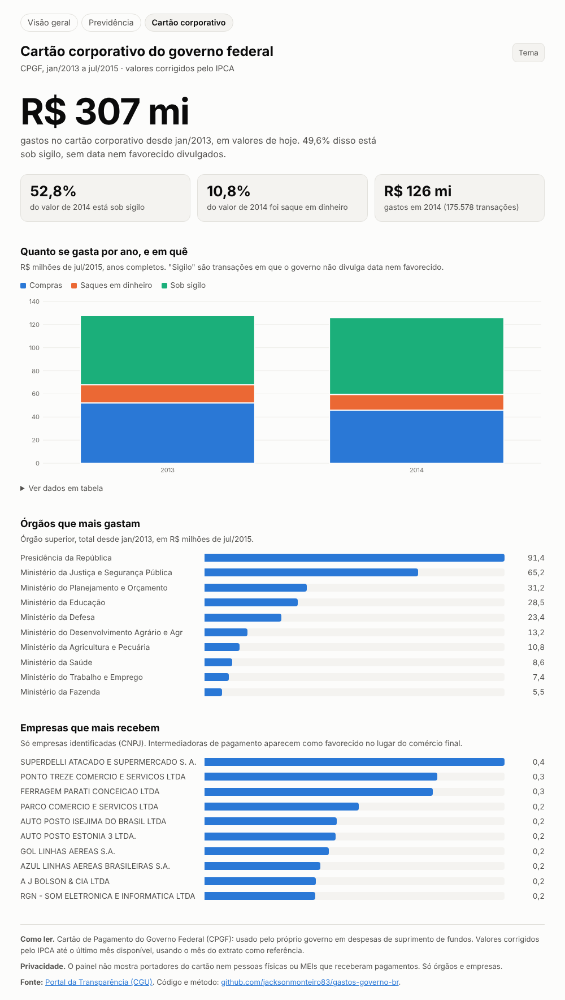

# Gastos do Governo Federal (Brasil)

Para onde vai o dinheiro do governo federal, em valores reais (corrigidos pelo IPCA) e em % do PIB. Dados abertos, pipeline automatizado e três painéis publicados.

**Site:** https://jacksonmonteiro83.github.io/gastos-governo-br/

| Visão geral | Previdência (INSS) | Cartão corporativo |
|---|---|---|
| [](https://jacksonmonteiro83.github.io/gastos-governo-br/) | [](https://jacksonmonteiro83.github.io/gastos-governo-br/previdencia.html) | [](https://jacksonmonteiro83.github.io/gastos-governo-br/cartao.html) |

## O que os dados mostram
- **Juros:** R$ 12,81 tri pagos em juros da dívida desde 1997, em valores de hoje, 20,8% de tudo que o governo central gastou. Só em 2025, R$ 933 bi (R$ 2,56 bi por dia), 10,7× o investimento federal.
- **Previdência (INSS/RGPS):** em 2025 a arrecadação líquida cobriu 69,1% dos benefícios; o Tesouro pagou a diferença, R$ 333 bi (2,5% do PIB). Em 1997 a cobertura era de 94%. Desde 2010, já descontada a inflação, os benefícios cresceram 72% e a arrecadação, 43%. A diferença chegou a 3,4% do PIB em 2020 e desde então recuou.
- **Envelhecimento:** a página de Previdência cruza a conta com a projeção de população do IBGE (revisão 2024): idosos de 65+ para cada 100 pessoas de 15 a 64 anos, de 2000 a 2070.
- **Cartão corporativo:** quase metade do valor gasto nos anos já processados está sob sigilo, sem data nem favorecido divulgados.

## Stack
- **Python / pandas** para ingestão (APIs e planilhas) e agregação
- **Parquet** como formato intermediário; **DuckDB + dbt (dbt-duckdb)** para a camada analítica (em construção)
- **GitHub Actions** para atualização diária, com commits do bot e testes antes de publicar
- **Painéis estáticos** (GitHub Pages) em `docs/`: HTML + SVG puro, sem dependências, com tooltip, tabela de dados e tema claro/escuro

## Fontes
| Fonte | Uso | Status |
|---|---|---|
| Tesouro Transparente | Resultado do Tesouro Nacional (RTN, desde 1997): juros, previdência, despesas, em valores correntes e em R$ constantes (IPCA) | implementado (`pipeline/tesouro.py`) |
| Banco Central (SGS) | IPCA (433), Selic mensal (4390), PIB 12m (4382); juros nominais 4606/4607 para conferência | implementado (`pipeline/bcb.py`, `pipeline/validar_juros.py`) |
| IBGE | Projeções da População, revisão 2024 (2000 a 2070) | implementado (`pipeline/agregar_demografia.py`) |
| Portal da Transparência | Cartão corporativo (CPGF), mensal | implementado (`pipeline/cpgf.py`, `pipeline/agregar_cpgf.py`) |
| Portal da Transparência | Despesas (empenho, liquidação, pagamento) | a implementar (`pipeline/transparencia.py`) |

## Estrutura
```
pipeline/     ingestão e agregação (gera Parquet em data/raw e os .js dos painéis)
dbt/          modelos SQL (staging e marts) e testes
tests/        testes Python (pytest)
docs/         site estático: index, previdencia, cartao + dados gerados (*_data.js) + img/
.github/      workflows: atualização diária, CPGF, validação dos juros, inspeções
```

## Como rodar
```bash
pip install -r requirements.txt
make ingest                                  # BCB + Tesouro para data/raw
python -m pipeline.agregar                   # docs/data.js (visão geral)
python -m pipeline.agregar_previdencia       # docs/previdencia_data.js
python -m pipeline.agregar_demografia        # docs/demografia_data.js
make test                                    # testes Python
make build                                   # dbt
```
Para publicar: Settings → Pages → Deploy from a branch → `main` / `/docs`. Para ver local, sirva `docs/` (`python -m http.server`) e abra no navegador.

## Observações de método
- **Juros** = juros nominais do governo central (critério abaixo-da-linha, fonte BCB), com o sinal invertido. É valor líquido. O workflow *Validar juros* compara com as séries do BCB do setor público consolidado: o perímetro é diferente, então os números não são idênticos.
- **Saúde e educação** = só despesas do Executivo sujeitas à programação financeira (linhas 4.4.1.3, 4.4.2.1, 4.4.1.4 e 4.4.2.2 da tabela 1.2-A). Folha de pessoal e Fundeb ficam em outras linhas. Essas séries, e a de investimento, só existem a partir de 2008.
- **Previdência** = arrecadação líquida para o RGPS (linha 1.3) e benefícios previdenciários (linha 4.1) do RTN. Não inclui servidores públicos (regimes próprios) nem o BPC. A "necessidade de financiamento" inclui a previdência rural, o que é parte do debate sobre o que contar como déficit. Os benefícios do RTN incluem precatórios e sentenças, então o total difere um pouco do divulgado pelo Ministério da Previdência. Os percentuais do PIB usam valores correntes e o PIB acumulado de dezembro.
- **Demografia** = projeção do IBGE, rotulada como projeção a partir de 2025. O painel não projeta o déficit da previdência.
- **Cartão corporativo:** valores corrigidos pelo IPCA usando o mês do extrato. Privacidade: portadores, pessoas físicas e MEIs não entram na saída, só órgãos e empresas.

## Limitações conhecidas
- A cobertura do cartão corporativo no site ainda não vai até o mês atual: os dados publicados hoje cobrem de jan/2013 a jul/2015 e estou investigando os meses seguintes.
- O dbt tem só o modelo de IPCA; os modelos do Tesouro e do CPGF ainda não foram escritos.

## Atualização
O workflow **Atualizar dados** roda todo dia, baixa as fontes, executa os testes e publica os `*_data.js`. O workflow **Atualizar CPGF** roda no dia 5 de cada mês, ou manualmente.
